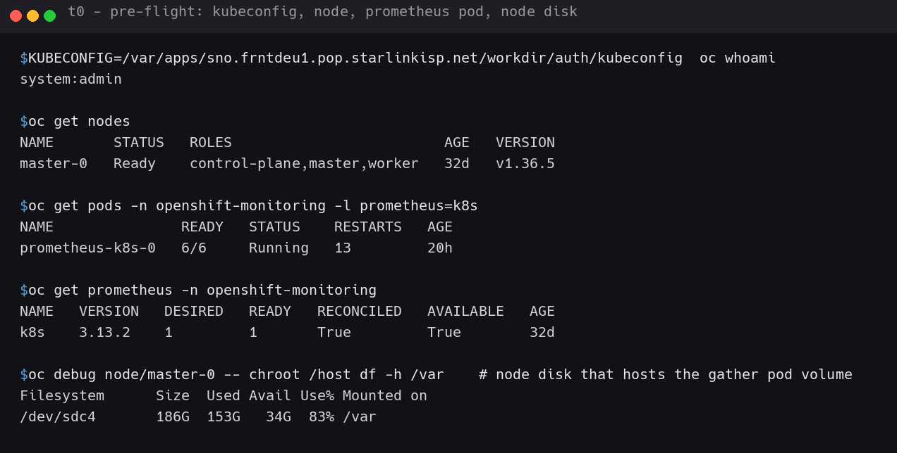
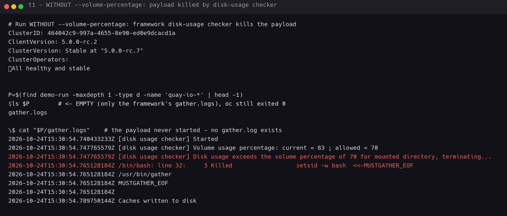
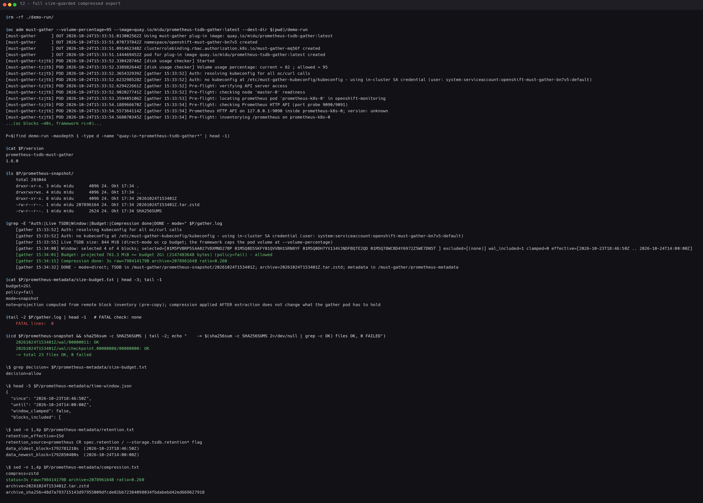
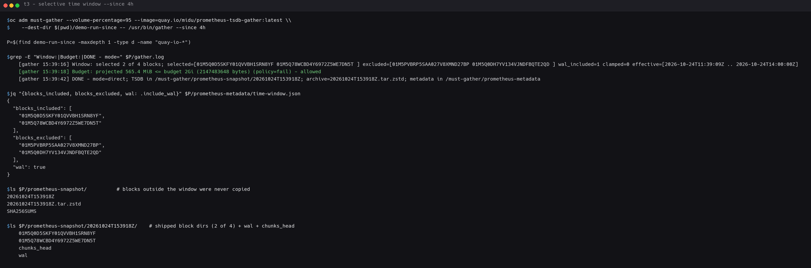
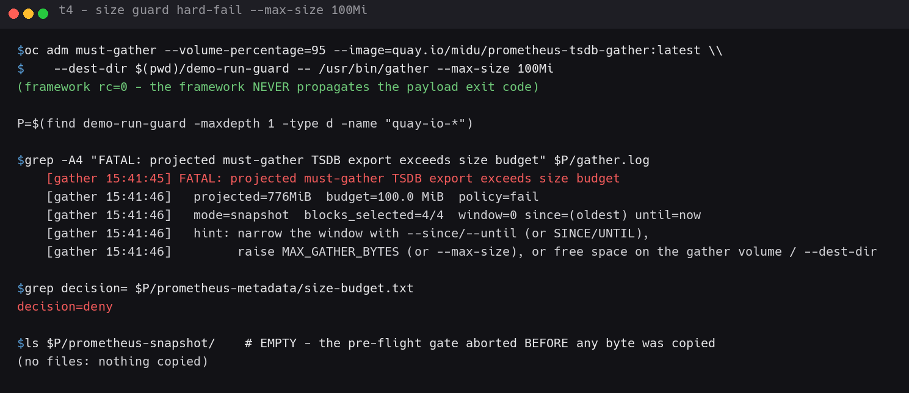
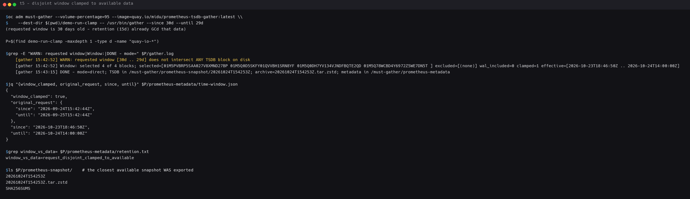
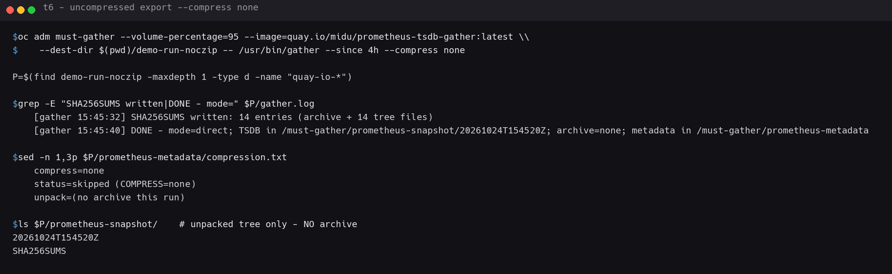

# gather Demo — every feature, step by step, with evidence

Live walkthrough of `prometheus-tsdb-gather` **v1.6.0 / `:latest`** driving all
its capabilities from `oc adm must-gather` itself — on the
`sno.frntdeu1.pop.starlinkisp.net` SNO cluster (Prometheus 3.13.2,
`prometheus-k8s-0`).

Every step shows the exact command **and** the observed output. Captured on
2026-10-24. Raw transcripts: [`../demo/evidence/`](../demo/evidence/).
Screenshot evidence: the `*.png` files referenced below (rendered by
[`../demo/render_term.py`](../demo/render_term.py) from those transcripts).

Companion doc: [`playback-demo.md`](./playback-demo.md) — opening the gathered
data locally and querying it.

---

## Step 0 — Pre-flight: cluster, user, prometheus pod, node disk

```bash
export KUBECONFIG=/var/apps/sno.frntdeu1.pop.starlinkisp.net/workdir/auth/kubeconfig
oc whoami
oc get nodes
oc get pods -n openshift-monitoring -l prometheus=k8s
oc get prometheus -n openshift-monitoring
oc debug node/master-0 -- chroot /host df -h /var
```

| What the run needs | Observed |
|---|---|
| cluster-admin kubeconfig | `system:admin` |
| node | `master-0` Ready, `v1.36.5` |
| prometheus pod (target of the extraction) | `prometheus-k8s-0` 6/6 Running |
| prometheus version | 3.13.2 (CR `k8s`) |
| node disk hosting the gather pod's `emptyDir` volume | `/dev/sdc4` 186G, **83% used, 34G free** |

That last row matters — see Step 1.



---

## Step 1 — Know why `--volume-percentage=95` is in the command

The must-gather **framework** (not `gather`) runs its own disk-usage checker
against the gather pod's volume at pod start, default allowance **70%**. The
node disk that hosts that volume is at 83% — so the raw command without the
flag gets the payload **SIGKILLed a few ms in**, `oc` exits 0, and the payload
directory rsyncs out EMPTY (only `gather.logs`).

Reproduction (what happens **without** the flag):

```bash
oc adm must-gather --image=quay.io/midu/prometheus-tsdb-gather:latest --dest-dir $(pwd)/demo-run
```

```
2026-10-24T15:30:54 [disk usage checker] Started
2026-10-24T15:30:54 [disk usage checker] Volume usage percentage: current = 83 ; allowed = 70
2026-10-24T15:30:54 [disk usage checker] Disk usage exceeds the volume percentage of 70 for mounted directory, terminating...
/bin/bash: line 32:     3 Killed   setsid -w bash /usr/bin/gather
```

`$P/gather.log` does not even exist — `gather` never started. `oc` still
returned 0; only the pod log tells you what happened.

**Fix / flag explained:** `--volume-percentage=95` raises *the framework's*
allowance, because the node volume legitimately sits above 70% and still has
plenty of free space. The flag acts on **the gather pod's `emptyDir` volume on
the node** — not on the local `--dest-dir` machine (the local copy happens
after the in-pod work is finished).



---

## Step 2 — The one command: full, size-guarded, compressed export

```bash
rm -rf ./demo-run/
oc adm must-gather --volume-percentage=95 \
    --image=quay.io/midu/prometheus-tsdb-gather:latest \
    --dest-dir $(pwd)/demo-run
```

~40s, `oc` exits 0. Locate the payload (its directory carries the image
**digest**, not the tag):

```bash
P=$(find demo-run -maxdepth 1 -type d -name 'quay-io-*prometheus-tsdb-gather*' | head -1)
```

Observed (key lines from `$P/gather.log`):

```
[gather 15:33:52] Auth: no kubeconfig at /etc/must-gather-kubeconfig/kubeconfig - using in-cluster SA credential (user: system:serviceaccount:openshift-must-gather-bn7v5:default)
[gather 15:33:55] Live TSDB size: 844 MiB (direct-mode oc cp budget; ...)
[gather 15:34:00] Window: selected 4 of 4 blocks; ... wal_included=1 clamped=0 effective=[2026-10-23T18:46:50Z .. 2026-10-24T14:00:00Z]
[gather 15:34:01] Budget: projected 761.3 MiB <= budget 2Gi (2147483648 bytes) (policy=fail) - allowed
[gather 15:34:15] Compression done: 3s raw=798414179B archive=207896164B ratio=0.260
[gather 15:34:32] DONE - mode=direct; TSDB in /must-gather/prometheus-snapshot/20261024T153401Z; archive=20261024T153401Z.tar.zstd; ...
```

**Capability 1 — size safeguard (pre-flight gate):** the budget check ran
*before a single byte was copied* (`projected 761.3 MiB <= 2Gi → allowed`).

```bash
cat $P/prometheus-metadata/size-budget.txt   # -> decision=allow
```

**Capability 4 — compression:** the 761 MiB extraction was zstd-archived in 3s
to 198 MiB (ratio 0.260):

```
$P/prometheus-snapshot/20261024T153401Z.tar.zstd   (207,896,164 B)
$P/prometheus-snapshot/SHA256SUMS
```

Integrity (no cluster needed):

```bash
(cd $P/prometheus-snapshot && sha256sum -c SHA256SUMS)   # 23 files OK, 0 failed
```

Full version + payload evidence:



---

## Step 3 — Capability 2: selective time-window export (`--since`)

Ship only the last 4 hours of data — blocks outside the window are
**selectively not copied** (source-side, block-granular):

```bash
oc adm must-gather --volume-percentage=95 \
    --image=quay.io/midu/prometheus-tsdb-gather:latest \
    --dest-dir $(pwd)/demo-run-since \
    -- /usr/bin/gather --since 4h
```

Observed:

```
Window: selected 2 of 4 blocks; selected=[01M5Q0D5SKFY01QVVBH1SRN8YF 01M5Q78WCBD4Y6972Z5WE7DN5T]
        excluded=[01M5PVBRP5SAA027V8XMND27BP 01M5Q0DH7YV134VJNDFBQTE2QD]
        wal_included=1 clamped=0 effective=[2026-10-24T11:39:09Z .. 2026-10-24T14:00:00Z]
Budget: projected 565.4 MiB <= budget 2Gi (policy=fail) - allowed
```

- `time-window.json` → `blocks_excluded` lists the 2 ULIDs that never left the pod;
- the unpacked tree physically contains only the 2 selected block dirs + `wal/` + `chunks_head/`;
- smaller projection → smaller download (565 MiB vs 761 MiB full).



---

## Step 4 — Capability 1b: size-guard **hard-fail** before any copy

Same export, but declare a budget it cannot meet. The gate aborts *pre-copy*:

```bash
oc adm must-gather --volume-percentage=95 \
    --image=quay.io/midu/prometheus-tsdb-gather:latest \
    --dest-dir $(pwd)/demo-run-guard \
    -- /usr/bin/gather --max-size 100Mi
```

Observed (machine-grepable FATAL block):

```
FATAL: projected must-gather TSDB export exceeds size budget
  projected=776MiB  budget=100.0 MiB  policy=fail
  mode=snapshot  blocks_selected=4/4  window=0 since=(oldest) until=now
  hint: narrow the window with --since/--until (or SINCE/UNTIL),
        raise MAX_GATHER_BYTES (or --max-size), or free space on the gather volume / --dest-dir
```

```
prometheus-metadata/size-budget.txt  ->  decision=deny
prometheus-snapshot/                 ->  EMPTY (nothing copied)
```

Note: `oc` exits 0 regardless — the framework does not propagate the payload
exit code; the verdict lives in `gather.log` / `size-budget.txt`. Add
`--size-policy warn` to log-and-continue instead of failing.



---

## Step 5 — Capability 3: retention awareness + disjoint-window **clamp**

Ask for a window (30 d old) that retention (15 d) already garbage-collected.
Since v1.4.0 this is **not** an error — the window is clamped to the
available data bounds and the closest snapshot is shipped, loudly:

```bash
oc adm must-gather --volume-percentage=95 \
    --image=quay.io/midu/prometheus-tsdb-gather:latest \
    --dest-dir $(pwd)/demo-run-clamp \
    -- /usr/bin/gather --since 30d --until 29d
```

Observed:

```
WARN: requested window [30d .. 29d] does not intersect ANY TSDB block on disk
Window: selected 4 of 4 blocks; ... wal_included=0 clamped=1
       effective=[2026-10-23T18:46:50Z .. 2026-10-24T14:00:00Z]
```

Evidence files:

- `time-window.json` → `"window_clamped": true` + the full `original_request`;
- `retention.txt` → `retention_effective=15d`, data bounds,
  `window_vs_data=request_disjoint_clamped_to_available`;
- the unpacked tree + archive still ship (the closest data the cluster has).



---

## Step 6 — Capability 4b: uncompressed export (`--compress none`)

No zstd step, tree only (e.g. for comparison or when you don't need a
transfer artifact):

```bash
oc adm must-gather --volume-percentage=95 \
    --image=quay.io/midu/prometheus-tsdb-gather:latest \
    --dest-dir $(pwd)/demo-run-noczip \
    -- /usr/bin/gather --since 4h --compress none
```

Observed:

```
SHA256SUMS written: 14 entries (archive + 14 tree files)
DONE - mode=direct; TSDB in /must-gather/prometheus-snapshot/20261024T154520Z; archive=none; ...
prometheus-metadata/compression.txt   ->  status=skipped (COMPRESS=none)
prometheus-snapshot/                ->  only 20261024T154520Z/ + SHA256SUMS (no archive)
```



---

## Feature → step map

| Feature | Step | Gate | Evidence |
|---|---|---|---|
| Framework volume guard (the `--volume-percentage` flag) | 0, 1 | framework, pod start | `disk usage checker` log; empty payload without the flag |
| Size safeguard (allow) | 2 | pre-flight, pre-copy | `Budget: ... allowed`, `size-budget.txt decision=allow` |
| Size safeguard (deny) | 4 | pre-flight, pre-copy | `FATAL: projected ... exceeds size budget`, `decision=deny`, empty snapshot |
| Time-window select | 3 | pre-flight select + extract | `Window: selected 2 of 4`, `blocks_excluded`, physically missing blocks |
| Retention / disjoint clamp | 5 | pre-flight select | `WARN ... intersect ANY block`, `window_clamped:true`, `window_vs_data=...` |
| Compression (zstd) | 2 | post-extract | `Compression done ... ratio=0.260`, `*.tar.zstd` + `SHA256SUMS -c` OK |
| Compression (none) | 6 | post-extract | `status=skipped (COMPRESS=none)`, tree only, `archive=none` |

## Evidence index

| PNG | Raw transcript |
|---|---|
| `../demo/t0-preflight.png` | `demo/evidence/t0-preflight.log` |
| `../demo/t1-kill-without-flag.png` | `demo/evidence/t1-without-flag-killed.evidence.log` |
| `../demo/t2-full-export.png` | `demo/evidence/t2-full-export.log` |
| `../demo/t3-time-window.png` | `demo/evidence/t3-time-window.log` |
| `../demo/t4-size-guard-denied.png` | `demo/evidence/t4-size-guard.log` |
| `../demo/t5-clamped-window.png` | `demo/evidence/t5-clamped-window.log` |
| `../demo/t6-compress-none.png` | `demo/evidence/t6-compress-none.log` |

Regenerate any PNG: `python3 demo/render_term.py demo/evidence/<file>.log demo/<file>.png "<title>"`
