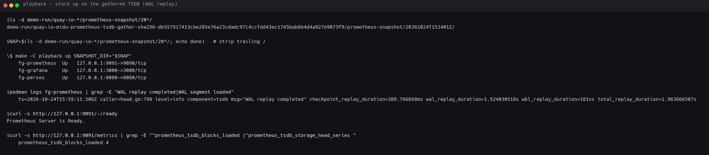
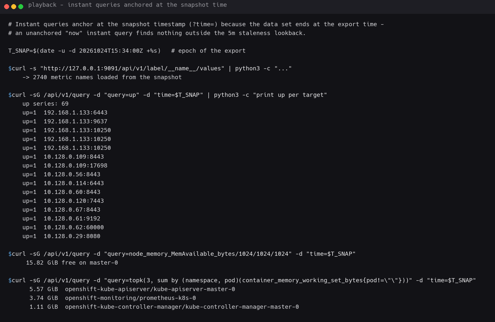
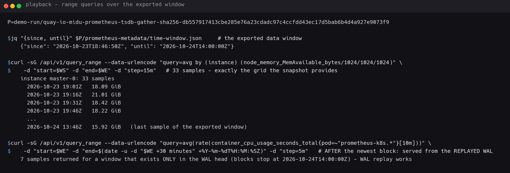
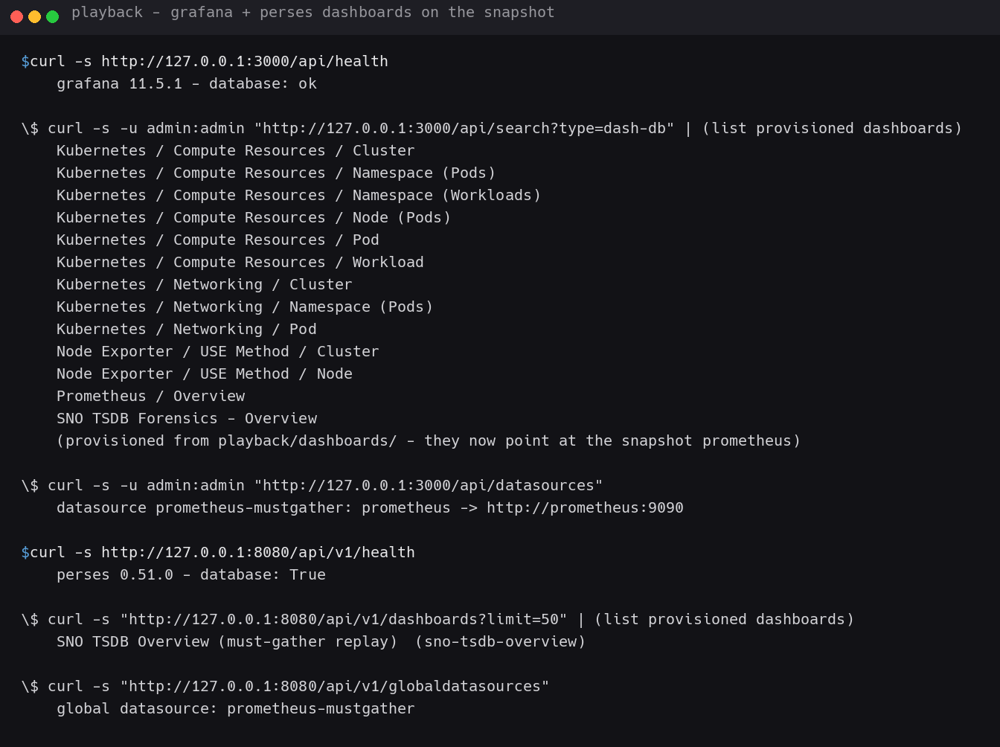
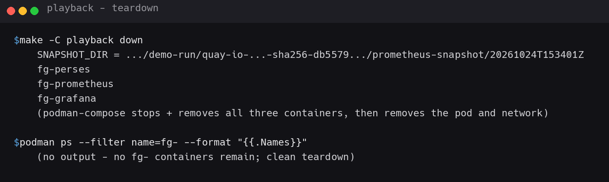

# playback Demo — open the gathered TSDB locally, dashboards + live queries

Follow-up to [`gather-demo.md`](./gather-demo.md): the full export from Step 2
landed as a plain TSDB tree in `demo-run`. This doc composes **that exact
data** onto the local [`../playback/`](../playback/) stack
(Prometheus + Grafana + Perses) and calls real queries against the resulting
Prometheus endpoint. Captured 2026-10-24 on the same machine.

> **No scraping happens.** The playback Prometheus is started purely to *read*
> the mounted snapshot (`scrape_configs: []` in
> [`../playback/prometheus.yml`](../playback/prometheus.yml)). Every series you
> see below is data that actually existed on the SNO prometheus — the dataset
> is frozen at export time.

The snapshot used:

```
demo-run/quay-io-midu-prometheus-tsdb-gather-sha256-db5579…/prometheus-snapshot/20261024T153401Z
  ├── 01M5PVBRP5SAA027V8XMND27BP/   ┐
  ├── 01M5Q0D5SKFY01QVVBH1SRN8YF/   ├ 4 blocks
  ├── 01M5Q0DH7YV134VJNDFBQTE2QD/   │  (2026-10-23T18:46:50Z .. 2026-10-24T14:00:00Z)
  ├── 01M5Q78WCBD4Y6972Z5WE7DN5T/   ┘
  ├── wal/                            ← replayed by prometheus on startup
  └── chunks_head/
```

---

## Step 1 — Locate the unpacked TSDB tree, bring the stack up

The `<UTC-ts>` directory directly under `prometheus-snapshot/` **is** the TSDB
root. Anything deeper (a single block dir) would start Prometheus on an empty
TSDB.

```bash
SNAP=$(ls -d demo-run/quay-io-*/prometheus-snapshot/20*/)
SNAP=${SNAP%/}
make -C playback up SNAPSHOT_DIR="$SNAP"
```

Observed — all three services up:

```
fg-prometheus  Up   127.0.0.1:9091->9090/tcp
fg-grafana     Up   127.0.0.1:3000->3000/tcp
fg-perses      Up   127.0.0.1:8080->8080/tcp
```

Prometheus re-opened the 4 blocks and **replayed the WAL** (this is what makes
a direct copy of a live TSDB safe):

```
ts=2026-10-24T15:59:11Z caller=head.go:798 level=info component=tsdb msg="WAL replay completed" ... total_replay_duration=1.963666507s
$ curl -s http://127.0.0.1:9091/-/ready
Prometheus Server is Ready.
$ curl -s http://127.0.0.1:9091/metrics | grep prometheus_tsdb_blocks_loaded
prometheus_tsdb_blocks_loaded 4
```

**2740 metric names** are now queryable
(`/api/v1/label/__name__/values`) — the full SNO metric universe
node-exporter, cAdvisor, kube-state-metrics, apiserver, …



---

## Step 2 — Instant queries (anchor with `?time=`)

Data ends at the export time (`2026-10-24T15:34:00Z`). An instant query
evaluated at "now" looks back only 5 min (staleness window) and finds nothing.
So anchor the query at the snapshot instant:

```bash
T_SNAP=$(date -u -d "2026-10-24T15:34:00Z" +%s)   # = 1792856040
curl -sG http://127.0.0.1:9091/api/v1/query \
     --data-urlencode "query=up" --data-urlencode "time=$T_SNAP"
```

Observed: **69 up-targets**, all `up=1` (kubelet 10250, apiserver 6443,
node exporter 9100-range, …).

```bash
curl -sG http://127.0.0.1:9091/api/v1/query \
     --data-urlencode "query=node_memory_MemAvailable_bytes/1024/1024/1024" \
     --data-urlencode "time=$T_SNAP"
# -> 15.82 GiB free on master-0        (the cluster's free RAM AT export time)

curl -sG http://127.0.0.1:9091/api/v1/query \
     --data-urlencode 'query=topk(3, sum by (namespace, pod) (container_memory_working_set_bytes{pod!=""}))' \
     --data-urlencode "time=$T_SNAP"
# -> 5.57 GiB  openshift-kube-apiserver/kube-apiserver-master-0
#    3.74 GiB  openshift-monitoring/prometheus-k8s-0
#    1.11 GiB  openshift-kube-controller-manager/kube-controller-manager-master-0
```



---

## Step 3 — Range queries over the exported window

The exported window comes straight from the gather metadata
(`prometheus-metadata/time-window.json` → `since=2026-10-23T18:46:50Z,
until=2026-10-24T14:00:00Z`):

```bash
curl -sG http://127.0.0.1:9091/api/v1/query_range \
     --data-urlencode 'query=avg by (instance) (node_memory_MemAvailable_bytes/1024/1024/1024)' \
     --data-urlencode "start=2026-10-23T18:46:50Z" \
     --data-urlencode "end=2026-10-24T14:00:00Z" \
     --data-urlencode "step=15m"
```

Observed — free RAM trend on `master-0` straight out of the export:

```
instance master-0: 33 samples
  2026-10-23 19:01Z   18.09 GiB
  2026-10-23 19:16Z   21.01 GiB
  2026-10-23 19:31Z   18.42 GiB
  2026-10-23 19:46Z   18.22 GiB
  ...
  2026-10-24 13:46Z   15.92 GiB   (last sample of the exported window)
```

**WAL proof:** a range window that starts *after* the newest block
(14:00Z) still returns data — it exists only in the replayed WAL head:

```bash
curl -sG http://127.0.0.1:9091/api/v1/query_range \
     --data-urlencode 'query=avg(rate(container_cpu_usage_seconds_total{pod=~"prometheus-k8s.*"}[10m]))' \
     --data-urlencode "start=2026-10-24T14:00:00Z" \
     --data-urlencode "end=2026-10-24T14:30:00Z" \
     --data-urlencode "step=5m"
# -> 7 samples (a window with zero block coverage, served from the WAL)
```



---

## Step 4 — Visualize: Grafana and Perses on the same endpoint

Both UIs are pre-provisioned (datasources + dashboards under
`../playback/`), both pointed at the playback Prometheus
(`http://prometheus:9090`, exposed to the host on 127.0.0.1:9091).

```bash
curl -s http://127.0.0.1:3000/api/health
# -> grafana 11.5.1 - database: ok

curl -s -u admin:admin "http://127.0.0.1:3000/api/dashboards/search?type=dash-db"
curl -s -u admin:admin "http://127.0.0.1:3000/api/datasources"
# -> datasource prometheus-mustgather: prometheus -> http://prometheus:9090

curl -s http://127.0.0.1:8080/api/v1/health
# -> perses 0.51.0 - database: ok
curl -s "http://127.0.0.1:8080/api/v1/dashboards?limit=50"
curl -s "http://127.0.0.1:8080/api/v1/globaldatasources"
# -> global datasource: prometheus-mustgather
```

Provisioned Grafana dashboards (all fed by the snapshot):

| Group | Dashboards |
|---|---|
| Overview | Prometheus / Overview, SNO TSDB Forensics - Overview |
| Node Exporter | USE Method / Cluster, USE Method / Node |
| Kubernetes / Compute | Cluster, Namespace (Pods), Namespace (Workloads), Node (Pods), Pod, Workload |
| Kubernetes / Networking | Cluster, Namespace (Pods), Pod |

Open in a browser (set the time range to the exported window
`2026-10-23 18:46 → 2026-10-24 14:00` UTC):

- **Grafana** → `http://127.0.0.1:3000` (admin / admin)
- **Perses** → `http://127.0.0.1:8080` — dashboard *SNO TSDB Overview
  (must-gather replay)*



---

## Step 5 — Teardown

```bash
make -C playback down
podman ps --filter name=fg- --format '{{.Names}}'   # -> (empty)
```

The snapshot tree in `demo-run/` is untouched — playback never rewrites it.



---

## Why this works (30-second theory)

1. The gather extracts a **crash-consistent** TSDB: N complete blocks + the
   live `wal/` + `chunks_head/` (`mode=direct`, nothing written back to the
   pod).
2. A standalone Prometheus opens that directory as its storage path
   (`--storage.tsdb.path=/prometheus`), loads the blocks, **replays the WAL**
   (`WAL replay completed` in the log) and serves queries — loss is at most a
   torn tail of the newest in-flight WAL segment.
3. Because scraping is disabled, the dataset is a **frozen forensic copy**:
   queries return exactly what the SNO prometheus had recorded, for the
   exported window `[since, until]`. Outside the window → empty result (that's
   the feature, not a bug — see `time-window.json` for what was selected).

## Evidence index

| PNG | Raw transcript |
|---|---|
| `../demo/t7-playback-up.png` | `demo/evidence/t7-playback-up.log` |
| `../demo/t8-queries-instant.png` | `demo/evidence/t8-queries-instant.log` |
| `../demo/t9-queries-range.png` | `demo/evidence/t9-queries-range.log` |
| `../demo/t10-grafana-perses.png` | `demo/evidence/t10-grafana-perses.log` |
| `../demo/t11-teardown.png` | `demo/evidence/t11-teardown.log` |
